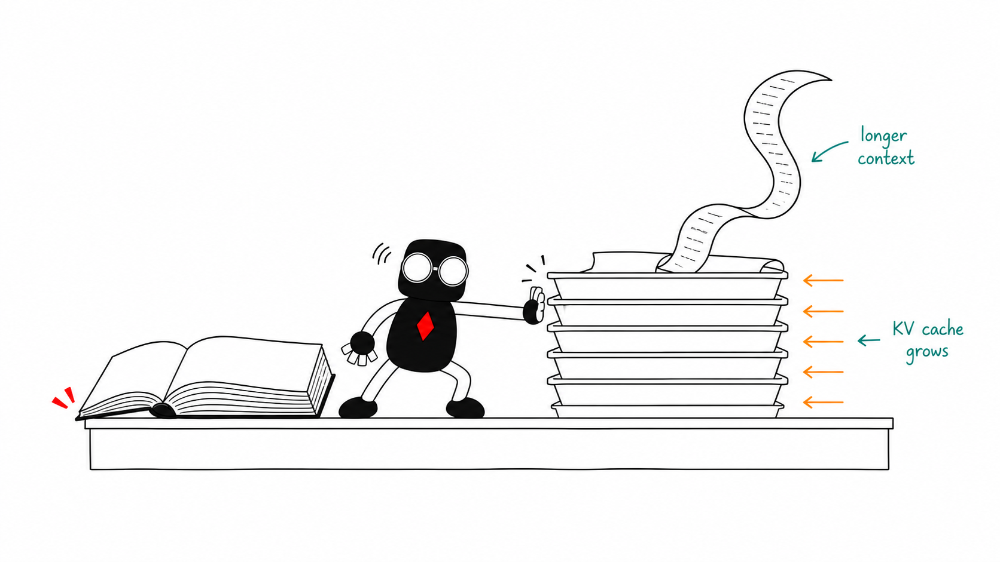

<!-- _class: hero -->
<!-- _paginate: false -->

# Local AI, explained with food

<!--
Timing: 40 seconds.

Most of us already know cloud AI. You send a request to somebody else's computers and get an answer back. Tonight, people will talk about running models on hardware you control. I want to give you enough vocabulary to follow the rest of the evening.

I will use one dinner setup throughout: the model is the cookbook, the runtime is the cook doing the work, and memory is the counter space everything has to share.

[Sources]
- Agentic Builders Collective logo supplied by the organiser.
- Cookbook-counter artwork generated on 14 September 2026 with character references from https://github.com/tinkertanker/tkrobot-stickers.
-->

---

<!-- _class: why-local-slide -->

# Why cook for yourself?

Local AI runs the model on hardware you control.

  
<strong>No bill for every serving</strong>Repeated work without a per-token API bill.

  
<strong>Private ingredients stay in your kitchen</strong>Prompts and files can stay on your device.

  
<strong>Your kitchen stays open</strong>Run offline after setup. Keep the model you choose.

You still pay for hardware, power and upkeep. Cloud features and connected tools can send data out.

<!--
Timing: 35 seconds.

Ordering delivery is convenient, but the bill adds up when you feed people all day. Local inference avoids a provider's per-token bill, which can help with repeated tasks and agents. It is not automatically cheaper: count hardware, electricity and maintenance.

You can keep private ingredients in your kitchen and cook without a connection. Download the model and runtime first. That offline promise covers inference, not web search or other connected tools. You also control which downloaded model version you keep, subject to its licence.

Optional example: Alex Ellis describes buying four DGX Sparks for private company workloads, including customer support and testing his own software for vulnerabilities. His motivation was control over sensitive data, rather than a guaranteed saving per token. Local models still need supervision and access controls.

[Sources]
- https://lmstudio.ai/docs/app/offline
- https://docs.ollama.com/faq
- Cost comparison is conditional, not a measured saving or break-even claim.
- https://blog.alexellis.io/how-and-why-we-bought-4-dgx-sparks/ (first-person experience, 15 September 2026)
- Original T Krobot hands-on-hips sticker: https://github.com/tinkertanker/tkrobot-stickers/blob/main/stickers/hands-on-hips.png
-->

---

<!-- _class: why-local-slide why-now-slide -->

# Why local is more practical now

More of the cooking kit is ready to use.

  
<strong>Cookbooks you can download</strong>Open-weight models for chat, coding and more.

  
<strong>Less to set up yourself</strong>Apps can download models and serve replies.

  
<strong>More ways to fit the book</strong>Quantisation cuts storage. GPUs speed up inference.

Quality and speed still depend on the model, hardware and task. Sometimes, ordering from the cloud is worth it.

<!--
Timing: 35 seconds.

Local models have been useful for years. What makes them approachable is the combination of downloadable models, easier software and efficient inference on personal hardware. Open-weight means you can obtain the weights under a licence. It does not automatically mean fully open-source or unrestricted use.

Apps can handle downloading and serving. Quantisation reduces the memory required for weights, with possible quality trade-offs. GPU acceleration can help, but a model that fits is not necessarily fast or good at your task. We will unpack those choices next, starting with the cookbook label.

[Sources]
- https://github.com/ggml-org/llama.cpp (model support, quantisation and hardware backends)
- https://lmstudio.ai/docs/app/offline (downloaded models and local serving)
- https://docs.ollama.com/faq (local execution and GPU/CPU placement)
- Original T Krobot happy sticker: https://github.com/tinkertanker/tkrobot-stickers/blob/main/stickers/happy.png
-->

---

<!-- _class: filename-slide -->

# Read the cookbook label

Qwen3.8<i>-</i>27B<i>-</i>Q4_K_M.gguf

Qwen3.8-27B Q4_K_M.gguf

  
<strong>Qwen3.8</strong>Cookbook series and edition

  
<strong>27B</strong>Size of the learned recipe knowledge

  
<strong>Q4_K_M</strong>More agak-agak, less storage

  
<strong>.gguf</strong>Packaging your cooking software can open

<!--
Timing: 45 seconds.

Think of this filename as a cookbook label. Qwen3.8 names the series and edition. The size label describes learned parameters, not a count of recipes or a guarantee of quality. This 27B variant is reported as about 28 billion parameters.

Q4_K_M records the measurements with less precision: more agak-agak, less storage. Technically, it is a roughly four-bit mixed K-quantisation preset. GGUF is the file packaging that compatible software can open, including llama.cpp-based tools. Packaging alone does not guarantee support for every model.

Next we look at the cooking setups that use these books.

[Sources]
- https://huggingface.co/Qwen/Qwen3.8-27B
- https://huggingface.co/bartowski/Qwen3.8-27B-GGUF/blob/main/README.md
- https://github.com/ggml-org/llama.cpp/blob/master/tools/quantize/README.md
- https://github.com/ggml-org/ggml/blob/master/docs/gguf.md
- Cookbook-label illustration regenerated on 12 September 2026 using T Krobot character references. The filename and annotations remain editable slide text.
-->

---

<!-- _class: runtime-tools-slide -->

# Same cookbook. Different setups.

  
<strong>llama.cpp</strong>lean local inference, especially GGUF

  
<strong>Ollama</strong>downloads, manages and runs models

  
<strong>LM Studio</strong>desktop GUI and local server

  
<strong>vLLM</strong>high-throughput GPU serving

  
<strong>SGLang</strong>programmable high-performance serving

<!--
Timing: 55 seconds.

Now we have read the cookbook label, here are the cooking setups. llama.cpp is a lean inference engine. Ollama manages and runs local models. LM Studio adds a desktop interface and local server. vLLM and SGLang focus on efficient serving, especially for many requests. The categories overlap, and the model format still has to match the software.

[Sources]
- https://github.com/ggml-org/llama.cpp
- https://docs.ollama.com/
- https://lmstudio.ai/docs/app/basics/lmstudio-vs-llmster-vs-lms
- https://docs.vllm.ai/en/latest/
- https://docs.sglang.io/
- Cooking-scene artwork generated on 12 September 2026 with character references from https://github.com/tinkertanker/tkrobot-stickers.
-->

---

<!-- _class: image-copy layers-slide -->

# Model, runtime and harness

  
<strong>Model: the cookbook</strong>Qwen, Gemma, DeepSeek, gpt-oss<small>The weights contain what it learned.</small>

  
<strong>Runtime: the cook</strong>Ollama, llama.cpp, vLLM, SGLang<small>Runs the model to generate replies.</small>

  
<strong>Harness: the host</strong>OpenClaw, OpenCode, Pi<small>Manages tools and the agent’s next steps.</small>

<!--
Timing: 55 seconds.

People often use one product name to mean the whole system. In this example, Qwen3.8 is the trained model, Ollama loads and serves it, and OpenClaw owns the conversation, tools and agent loop. Products can span layers, but asking which layer is responsible makes both performance and debugging easier to discuss.

Qwen, Gemma, DeepSeek and gpt-oss are model families. llama.cpp, vLLM and SGLang provide inference runtimes, while Ollama packages model management and serving around inference engines. OpenCode and Pi are coding-agent harnesses. These examples are not a promise that every model works with every runtime or harness. LM Studio, shown on the previous slide, bundles an interface and local serving around supported engines.

[Sources]
- https://huggingface.co/Qwen/Qwen3.8-27B
- https://docs.ollama.com/
- https://github.com/openclaw/openclaw/blob/main/docs/concepts/agent-loop.md
- https://opencode.ai/docs/
- https://github.com/earendil-works/pi
- https://docs.sglang.io/
- https://ai.google.dev/gemma/docs
- Cooking-scene artwork generated on 12 September 2026 with character references from https://github.com/tinkertanker/tkrobot-stickers.
-->

---

<!-- _class: architecture-slide -->

# Dense vs MoE

A token is a small piece of text, often part of a word.

  

    <h2>DENSE</h2>
    
Most weights are used for every token.

    <strong>Most of the book → each token</strong>
  

  

    <h2>MIXTURE OF EXPERTS</h2>
    
Only selected expert blocks are active for each token.

    <strong>35B total → 3B active</strong>
    <small>Qwen3.6-35B-A3B</small>
  

<strong>Total parameters</strong> shape what must fit. <strong>Active parameters</strong> are a rough guide to work per token.

<!--
Timing: 60 seconds.

A token is a small piece of text, often part of a word. Dense and MoE describe parameter routing. A dense model uses most of its weights for each token. An MoE model keeps all expert weights available, then routes each token through only some expert blocks. Both store the whole cookbook.

Qwen3.6-35B-A3B is the useful filename example: about 35 billion parameters in total and 3 billion activated for a token. A3B describes the active path, not the memory needed to load the model. Total parameters shape storage; active parameters are only a rough guide to computation, not guaranteed speed.

Other labels answer different questions. Transformer, state-space model and hybrid describe the sequence backbone. Text-only and multimodal describe inputs. Base, instruct, reasoning and distilled describe training or behaviour. These labels can stack on one model.

[Sources]
- https://arxiv.org/abs/2211.15841
- https://huggingface.co/Qwen/Qwen3.6-35B-A3B
- https://arxiv.org/abs/2312.00752
- https://www.ai21.com/blog/announcing-jamba/
- Paired cookbook artwork generated on 12 September 2026 with character references from https://github.com/tinkertanker/tkrobot-stickers.
-->

---

<!-- _class: quant-slide -->

# Quantisation

  <strong>In a recipe, you can measure precisely, or just agak-agak (roughly).</strong>
  The same learned numbers can be stored using fewer bits.

FORMATROUGH WEIGHT STORAGERECIPE VERSION

<strong>BF16 / FP16</strong>about 2 bytes per parameterfine-grained measuring marks

<strong>FP8 / INT8</strong>about 1 byte per parameterround to the nearest gram

<strong>INT4</strong>about half a byte, plus scaleschoose one of 16 measuring marks

<strong>NVFP4</strong>4-bit values, plus scales16 marks, rescaled for each small block

<!--
Timing: 50 seconds.

Quantisation stores the model's learned numbers with fewer possible values. It is lossy rounding, not ZIP compression.

The format names tell you how the numbers are represented. BF16 and FP16 use about two bytes per parameter. Eight-bit formats use about one. Four-bit formats use about half a byte per parameter before scales and other metadata.

NVFP4 stores 4-bit floating-point values with block and tensor-wide scales. MXFP4 is another block-scaled 4-bit format used for most of the MoE weights in gpt-oss. Quality and speed vary with the model, runtime and task.

[Sources]
- https://docs.nvidia.com/deeplearning/tensorrt/latest/inference-library/data-format-desc.html
- https://docs.nvidia.com/deeplearning/transformer-engine/user-guide/features/low_precision_training/nvfp4/nvfp4.html
- https://cdn.openai.com/pdf/419b6906-9da6-406c-a19d-1bb078ac7637/oai_gpt-oss_model_card.pdf
-->

---

<!-- _class: image-copy memory-slide -->

# A model must fit — and be read quickly

  
<strong>VRAM capacity</strong> How much can fit at once

  
<strong>Memory bandwidth</strong> How quickly weights can be read

VRAM is GPU memory. Bandwidth is measured in gigabytes per second (GB/s).

<!--
Timing: 40 seconds.

Capacity and bandwidth answer different questions. VRAM capacity is the size of the counter. The model weights, the current context and temporary working memory must share it.

Memory bandwidth is how quickly the hardware can read those weights while generating. A machine can have enough capacity for a large model and still generate slowly. Another machine can be fast but too small for the model you want.

[Sources]
- https://developer.nvidia.com/blog/mastering-llm-techniques-inference-optimization/
- Illustration generated for this deck using the T Krobot illustration skill from https://github.com/tinkertanker/tkrobot-stickers on 27 August 2026.
-->

---

<!-- _class: image-copy kv-slide -->

# Longer chats use more memory

  
<strong>Context</strong> The text the model can currently attend to

  
<strong>KV cache</strong> Saved attention work from earlier tokens

<!--
Timing: 45 seconds.

Tokens are small pieces of text. Context is the instructions, conversation and generated text that the model can currently attend to.

While processing that text, the model computes attention data called keys and values. The KV cache keeps those results so the model does not redo all of that attention work for every new token.

As the context grows, the KV cache grows too. That is why a model that fits with a short prompt can run out of memory with a very long conversation or many simultaneous users.

Prefix caching reuses KV data for an identical beginning of a later request, if the runtime supports it and the cache remains available. Think of keeping the same prepared ingredients ready for the next order. A cache hit reduces repeated prefill work, not the work of generating the new reply. A cold prompt has no reusable prefix cached. This is different from whether the model itself is already loaded.

[Sources]
- https://huggingface.co/docs/transformers/main/en/kv_cache
- https://docs.vllm.ai/en/latest/features/automatic_prefix_caching/
- Illustration generated for this deck using the T Krobot illustration skill from https://github.com/tinkertanker/tkrobot-stickers on 27 August 2026.
-->

---

<!-- _class: image-copy speed-slide -->

# TTFT and TPS

  
<strong>TTFT</strong>Time to first token<small><b>Prefill:</b> process the prompt before answering</small>

  
<strong>TPS</strong>Tokens per second after that<small><b>Decode:</b> generate the reply one token at a time</small>

<!--
Timing: 40 seconds.

Two systems can both feel slow, for different reasons. TTFT means time to first token: how long you wait before anything appears. Prefill is the phase where the model processes the prompt before producing that first output token.

TPS means tokens per second after generation has started. Decode is the phase where the model generates the answer one token at a time.

For an interactive chat you care about both. A good TPS number does not rescue a long wait for the first token.

[Sources]
- https://docs.vllm.ai/en/latest/features/per_request_metrics/
- https://docs.vllm.ai/en/v0.22.0/usage/metrics/
- Serving-hatch artwork generated on 12 September 2026. Original palm-open and running-right stickers from https://github.com/tinkertanker/tkrobot-stickers/tree/f4e93c2ba5c8c955e39c564491f6c4b22b7d1f7d/stickers, used unchanged.
-->

---

<!-- _class: benchmark-slide -->

# Speed claims need a recipe

How many orders, what dish, and how much prep?

  
<strong>C1 / C4: concurrency</strong>One / four requests in flight. One agent can launch several.

  
<strong>Cold prompt / prefix cache hit</strong>Prep from scratch, or reuse matching earlier work.

  
<strong>Per-user speed / total throughput</strong>Your plates per minute, or the whole kitchen’s output?

  
<strong>Speculative decoding / acceptance rate</strong>A drafter suggests tokens. The main model checks them. How many suggestions survive?

A useful benchmark shows how long you wait and how fast the reply arrives, using the same task and settings.

<!--
Timing: 55 seconds.

C1 and C4 are benchmark shorthand for one and four concurrent requests, not necessarily people or GPUs. Four subagents can create four requests, and an active parent can add another. More simultaneous requests can increase total server output while slowing each user's stream. Report both, and include time waiting in the queue when measuring the user's experience.

Cold versus cached here refers to the prompt prefix. Keep model load state separate. Fix input and output lengths, reasoning settings, model/quantisation, hardware and runtime when comparing runs.

Speculative decoding uses a cheaper proposal method, such as a smaller draft model, then verifies proposed tokens with the target model. Acceptance rate is the fraction of proposed tokens accepted. High acceptance can help, but drafting and verification also cost time. It does not guarantee a speed-up. MTP means multi-token prediction, another approach used to propose several tokens. Exact supported methods depend on the model and runtime.

Alex Ellis reports that a two-Spark recipe advertised 65–85 tokens/s on a counting task, while his typical use was around 30–40. Those are his observations, not our benchmark or a hardware guarantee. The practical lesson is to test representative work rather than copy a headline number.

[Sources]
- https://blog.alexellis.io/how-and-why-we-bought-4-dgx-sparks/ (workload example and motivation for this slide)
- https://docs.vllm.ai/en/latest/cli/bench/serve/ (concurrency and controlled benchmark inputs)
- https://docs.vllm.ai/en/latest/features/automatic_prefix_caching/
- https://docs.vllm.ai/en/latest/features/speculative_decoding/
- Original sticker: https://github.com/tinkertanker/tkrobot-stickers/blob/main/stickers/sus.png
-->

---

<!-- _class: tp-slide -->

# One model, several GPUs — constant coordination

  
<strong>TP</strong>Split one model across GPUs

  
<strong>Within one node</strong>NVLink in supported systems

  
<strong>Between nodes</strong>RoCE or InfiniBand

<strong>NCCL</strong>: software that coordinates GPU communication

<!--
Timing: 55 seconds.

Tensor parallelism splits one model's tensor operations and weights across several GPUs. Each GPU does part of the work, then exchanges partial results with the others again and again.

A node is one machine. NVLink connects GPUs inside supported systems. RoCE means RDMA over Converged Ethernet, and InfiniBand is another fast network fabric used between machines.

The important point is that combining memory is not enough. These GPUs have to communicate constantly, so the interconnect affects performance.

NCCL, pronounced nickel, is NVIDIA's Collective Communications Library. It supplies operations that exchange and combine data among GPUs, within or across machines. In the kitchen analogy, it organises the hand-offs between cooks. The network fabric is the connection those hand-offs travel over. TP4 means four tensor-parallel participants, not four independent model copies. Linking machines does not automatically turn their RAM into one transparent pool.

[Sources]
- https://docs.vllm.ai/en/latest/serving/parallelism_scaling/
- https://docs.nvidia.com/deeplearning/nccl/user-guide/docs/overview.html
- https://docs.nvidia.com/networking-ethernet-software/cumulus-linux/Layer-1-and-Switch-Ports/Quality-of-Service/RDMA-over-Converged-Ethernet-RoCE/
- Shared-recipe artwork generated on 12 September 2026 with character references from https://github.com/tinkertanker/tkrobot-stickers.
-->

---

<!-- _class: memory-headroom-slide -->

# The model fits. The conversation might not.

  
<strong>Short chat</strong>Room for context and working memory

  
<strong>Long chat</strong>Same weights, larger KV cache

<!--
Timing: 35 seconds.

Model weights are only one part of the memory budget. As a conversation grows, the runtime keeps more key-value cache so the model can attend to earlier tokens. That extra cache competes with the weights, temporary working memory and the operating system. This illustration is conceptual, not a benchmark: the exact cost depends on architecture, context length, precision and cache settings.

[Sources]
- https://huggingface.co/docs/transformers/main/en/kv_cache
- Illustration generated for this deck using the T Krobot illustration skill from https://github.com/tinkertanker/tkrobot-stickers on 5 September 2026.
-->

---

<!-- _class: fit-slide fit-combined -->

# What fits in local memory?

These examples may fit in memory, but that does not tell you how fast they run.

  
Memory targetModelWhat the size means

  
<strong>8 GB</strong>Gemma 4 E4BQ4_0 load ≈ 4.5 GB

  
<strong>16 GB</strong>Gemma 4 12B AbliteratedMLX 4-bit file 6.7 GB; Mac 24 GB advised

  
<strong>16 GB</strong>gpt-oss-20bOpenAI: runs in 16 GB with MXFP4

  
<strong>24 GB</strong>Qwen3.8-27BQ4_K_M file 17.8 GB

  
<strong>24 GB</strong>Gemma 4 31BQ4_0 load ≈ 17.5 GB

  
<strong>80 GB</strong>gpt-oss-120bOpenAI: one 80 GB GPU, MXFP4

  
<strong>128 GB*</strong>DeepSeek-V4-Flash-0731UD-IQ2_XXS file 90.9 GB; aggressive quant

  
<strong>256 GB*</strong>GLM-5.2UD-IQ1_S file 217 GB; aggressive quant

The model shares memory with its context and software, including the OS on unified-memory systems. <small>*We have not tested the 128/256 GB setups. Their low-bit quantisation may reduce quality.</small>

<!--
Timing: 60 seconds.

Treat these as indicative targets, not promises. The publisher-backed gpt-oss entries are the strongest claims here. The Gemma figures are Google's Q4_0 loading estimates, including its stated loading allowance but excluding context and supporting software. Qwen's 17.8 GB is the GGUF file, not a measured runtime footprint. The Abliterated example is a community MLX build for Apple Silicon: its publisher asks for at least 16 GB of unified memory and recommends 24 GB. Abliteration changes refusal behaviour; it is separate from quantisation.

DeepSeek UD-IQ2_XXS and GLM UD-IQ1_S are community mixed low-bit quants. Their files are 90.9 GB and 217 GB respectively. The 128/256 GB targets are candidate experiments, not verified fits or hardware recommendations. File size is not a complete runtime budget. Context, cache and software need headroom, and unified memory also serves the OS. Aggressive low-bit quantisation can reduce quality; speed and quality depend on the runtime and task. Sources checked 5 September 2026. Present representative rows rather than reading every file name aloud.

[Sources]
- https://ai.google.dev/gemma/docs/core
- https://huggingface.co/IITheLordII/gemma-4-12B-it-abliterated-mlx-4bit
- https://huggingface.co/Qwen/Qwen3.8-27B
- https://huggingface.co/bartowski/Qwen3.8-27B-GGUF/blob/main/README.md
- https://openai.com/index/introducing-gpt-oss/
- https://huggingface.co/deepseek-ai/DeepSeek-V4-Flash
- https://huggingface.co/deepseek-ai/DeepSeek-V4-Flash-0731
- https://huggingface.co/unsloth/DeepSeek-V4-Flash-0731-GGUF/tree/main/UD-IQ2_XXS
- https://huggingface.co/zai-org/GLM-5.2
- https://huggingface.co/unsloth/GLM-5.2-GGUF
- https://huggingface.co/docs/transformers/main/en/kv_cache
-->

---

<!-- _class: end-slide -->
<!-- _paginate: false -->

# Fits. Fast. Worth it?

  
<strong>Fits?</strong>Weights, context and working memory

  
<strong>Fast?</strong>Bandwidth, TTFT and TPS

  
<strong>Worth it?</strong>Privacy and control versus effort and trade-offs

<!--
Timing: 20 seconds.

Local AI comes down to three questions: does the whole cookbook fit on the counter, do the plates arrive fast enough, and is running your own kitchen worth it? Now, when someone says “27B Q4 GGUF”, you know what to ask next.

[Sources]
- Table artwork generated on 12 September 2026. Original rubbing-tummy sticker from https://github.com/tinkertanker/tkrobot-stickers/tree/f4e93c2ba5c8c955e39c564491f6c4b22b7d1f7d/stickers, used unchanged.
-->
