<!-- _class: hero -->
<!-- _paginate: false -->

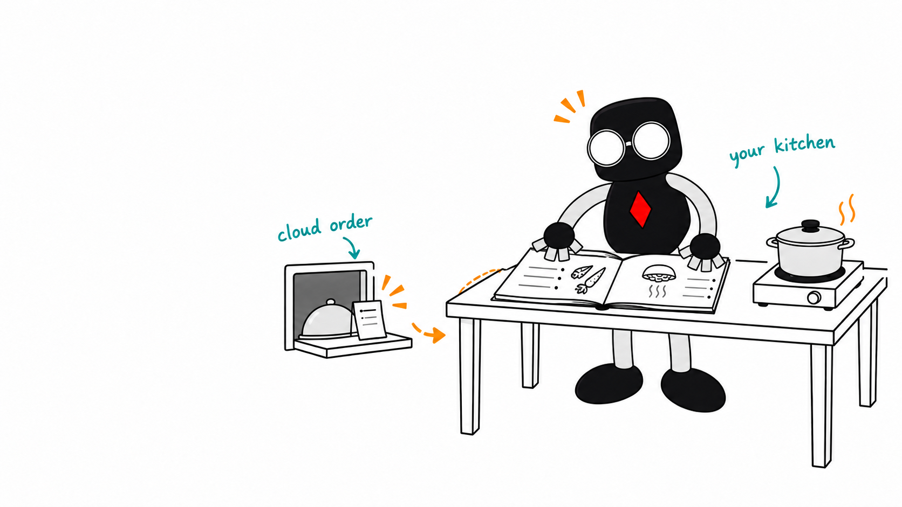
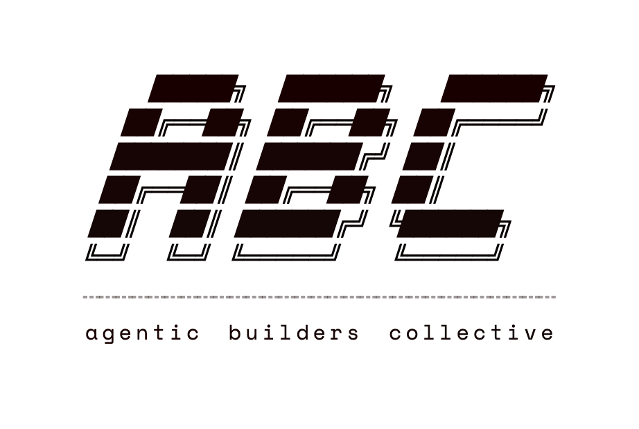

# Local AI, explained with food

<!--
Timing: 40 seconds.

Most of us already know cloud AI. You send a request to somebody else's computers and get an answer back. Tonight, people will talk about running models on hardware you control. I want to give you enough vocabulary to follow the rest of the evening.

I will use one dinner setup throughout: the model is the cookbook, the runtime is the cook doing the work, and memory is the counter space everything has to share.

[Sources]
- Agentic Builders Collective logo supplied by the organiser.
- Cookbook-counter artwork generated on 14 September 2026 with character references from https://github.com/tinkertanker/tkrobot-stickers.
-->

---

<!-- _class: why-local-slide -->

# Why cook for yourself?

Local AI runs the model on hardware you control.

  
<strong>No bill for every serving</strong>Repeated work without a per-token API bill.

  
<strong>Private ingredients stay in your kitchen</strong>Prompts and files can stay on your device.

  
<strong>Your kitchen stays open</strong>Run offline after setup. Keep the model you choose.

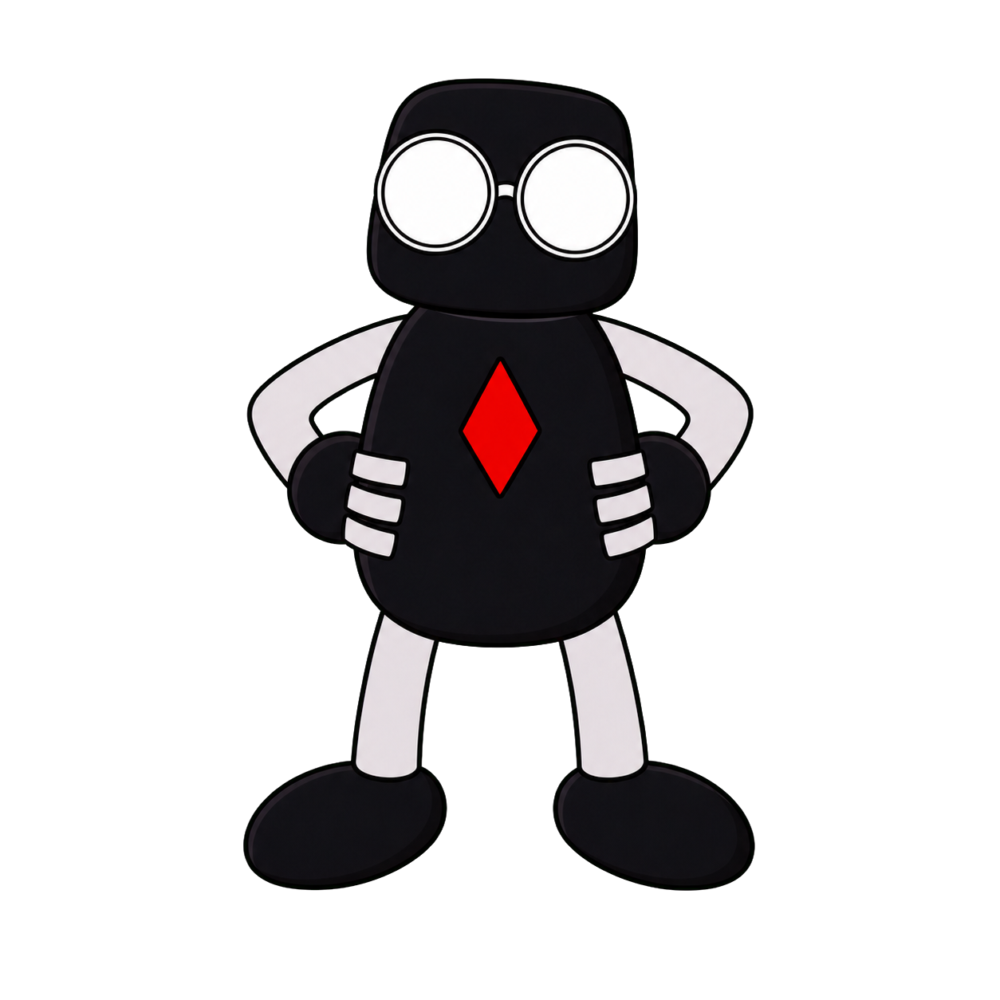

You still pay for hardware, power and upkeep. Cloud features and connected tools can send data out.

<!--
Timing: 35 seconds.

Ordering delivery is convenient, but the bill adds up when you feed people all day. Local inference avoids a provider's per-token bill, which can help with repeated tasks and agents. It is not automatically cheaper: count hardware, electricity and maintenance.

You can keep private ingredients in your kitchen and cook without a connection. Download the model and runtime first. That offline promise covers inference, not web search or other connected tools. You also control which downloaded model version you keep, subject to its licence.

Optional example: Alex Ellis bought four DGX Sparks for his company's private workloads, including testing its own software for vulnerabilities without sending proprietary code to a cloud provider. His reason was control over sensitive data rather than a saving per token. Local models still need supervision and access controls.

[Sources]
- https://lmstudio.ai/docs/app/offline
- https://docs.ollama.com/faq
- https://blog.alexellis.io/how-and-why-we-bought-4-dgx-sparks/ (first-person experience, 15 September 2026)
- Original T Krobot hands-on-hips sticker: https://github.com/tinkertanker/tkrobot-stickers/blob/main/stickers/hands-on-hips.png
-->

---

<!-- _class: why-local-slide why-now-slide -->

# Why local is more practical now

More of the cooking kit is ready to use.

  
<strong>Cookbooks you can download</strong>Open-weight models for chat, coding and more.

  
<strong>Less to set up yourself</strong>Apps can download models and serve replies.

  
<strong>More ways to fit the book</strong>Quantisation shrinks models. Machines with large unified memory hold more.

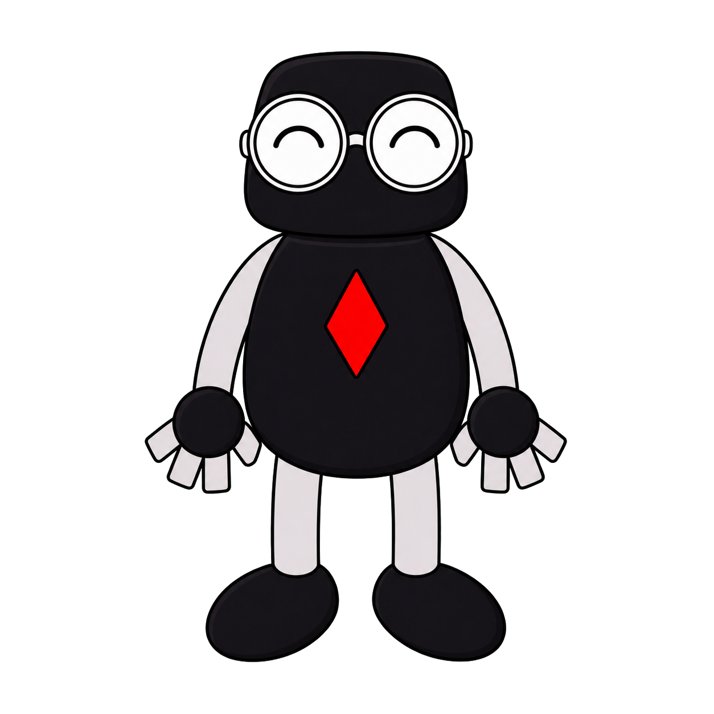

Quality and speed still depend on the model, hardware and task. Sometimes, ordering from the cloud is worth it.

<!--
Timing: 35 seconds.

Local models have been useful for years. What makes them approachable is the combination of downloadable models, easier software and efficient inference on personal hardware. Open-weight means you can obtain the weights under a licence. It does not automatically mean fully open-source or unrestricted use.

Apps can handle downloading and serving. Quantisation reduces the memory required for weights, with possible quality trade-offs. Macs and machines like the DGX Spark share one large pool of memory between the CPU and GPU, so bigger models fit. A model that fits can still be slow, or bad at your task. Next, the cookbook label.

[Sources]
- https://github.com/ggml-org/llama.cpp (model support, quantisation and hardware backends)
- https://lmstudio.ai/docs/app/offline (downloaded models and local serving)
- https://docs.ollama.com/faq (local execution and GPU/CPU placement)
- Original T Krobot happy sticker: https://github.com/tinkertanker/tkrobot-stickers/blob/main/stickers/happy.png
-->

---

<!-- _class: filename-slide -->

# Read the cookbook label

Qwen3.8<i>-</i>27B<i>-</i>Q4_K_M.gguf

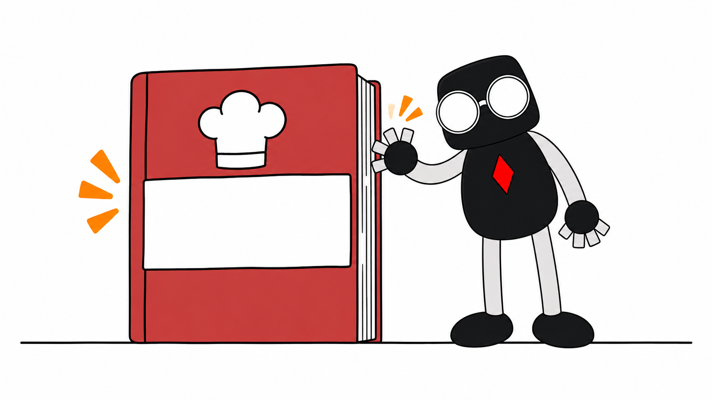

Qwen3.8-27B Q4_K_M.gguf

  
<strong>Qwen3.8</strong>Cookbook series and edition

  
<strong>27B</strong>Size of the learned recipe knowledge

  
<strong>Q4_K_M</strong>More agak-agak, less storage

  
<strong>.gguf</strong>Packaging your cooking software can open

<!--
Timing: 45 seconds.

Think of this filename as a cookbook label. Qwen3.8 names the series and edition. 27B is the number of learned parameters: about 28 billion for this model. Bigger models tend to know more, and they need more memory.

Q4_K_M records the measurements with less precision: more agak-agak, less storage. Technically, it is a roughly four-bit mixed K-quantisation preset. GGUF is the file packaging that compatible software can open, including llama.cpp-based tools.

Next we look at the cooking setups that use these books.

[Sources]
- https://huggingface.co/Qwen/Qwen3.8-27B
- https://huggingface.co/bartowski/Qwen3.8-27B-GGUF/blob/main/README.md
- https://github.com/ggml-org/llama.cpp/blob/master/tools/quantize/README.md
- https://github.com/ggml-org/ggml/blob/master/docs/gguf.md
- Cookbook-label illustration regenerated on 12 September 2026 using T Krobot character references.
-->

---

<!-- _class: runtime-tools-slide -->

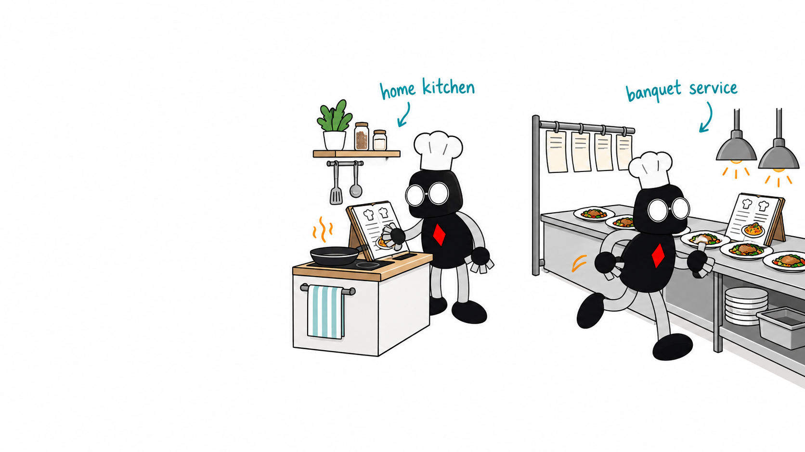

# Same cookbook. Different setups.

  
<strong>llama.cpp</strong>lean C/C++ engine for GGUF models

  
<strong>Ollama</strong>downloads, manages and runs models

  
<strong>LM Studio</strong>desktop GUI and local server

  
<strong>vLLM</strong>high-throughput GPU serving

  
<strong>SGLang</strong>programmable high-performance serving

<!--
Timing: 55 seconds.

Now we have read the cookbook label, here are the cooking setups. llama.cpp is a lean C/C++ inference engine that runs GGUF files on CPUs and GPUs. Ollama manages and runs local models. LM Studio adds a desktop interface and local server. vLLM and SGLang focus on efficient serving, especially for many requests. The categories overlap, and the model format still has to match the software.

[Sources]
- https://github.com/ggml-org/llama.cpp
- https://docs.ollama.com/
- https://lmstudio.ai/docs/app/basics/lmstudio-vs-llmster-vs-lms
- https://docs.vllm.ai/en/latest/
- https://docs.sglang.io/
- Cooking-scene artwork generated on 12 September 2026 with character references from https://github.com/tinkertanker/tkrobot-stickers.
-->

---

<!-- _class: image-copy layers-slide -->

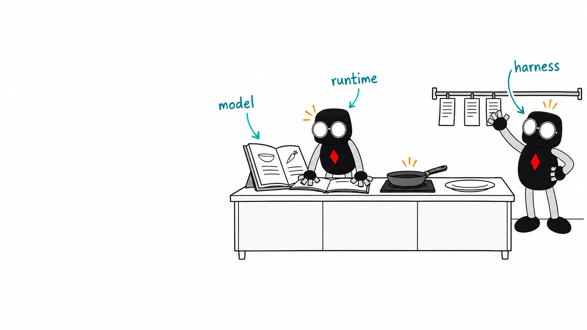

# Model, runtime and harness

  
<strong>Model: the cookbook</strong>Qwen, Gemma, DeepSeek, gpt-oss<small>The weights contain what it learned.</small>

  
<strong>Runtime: the cook</strong>Any setup from the last slide<small>Runs the model to generate replies.</small>

  
<strong>Harness: the manager</strong>OpenClaw, OpenCode, Pi<small>Manages tools and the agent’s next steps.</small>

<!--
Timing: 55 seconds.

People often use one product name to mean the whole system. In this example, Qwen3.8 is the trained model, Ollama loads and serves it, and OpenClaw owns the conversation, tools and agent loop. Some products cover more than one layer. When something is slow or broken, ask which layer is at fault.

Qwen, Gemma, DeepSeek and gpt-oss are model families. The runtimes are the setups from the previous slide. OpenCode and Pi are coding-agent harnesses. Not every model works with every runtime or harness.

[Sources]
- https://huggingface.co/Qwen/Qwen3.8-27B
- https://docs.ollama.com/
- https://github.com/openclaw/openclaw/blob/main/docs/concepts/agent-loop.md
- https://opencode.ai/docs/
- https://github.com/earendil-works/pi
- https://docs.sglang.io/
- https://ai.google.dev/gemma/docs
- Cooking-scene artwork generated on 12 September 2026 with character references from https://github.com/tinkertanker/tkrobot-stickers.
-->

---

<!-- _class: architecture-slide -->

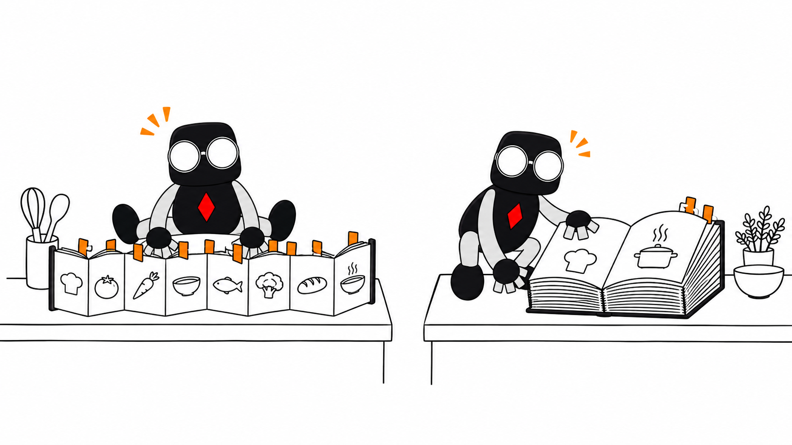

# Dense vs MoE

A token is a small piece of text, often part of a word.

  

    <h2>DENSE</h2>
    
All weights are used for every token.

    <strong>The whole book → each token</strong>
  

  

    <h2>MIXTURE OF EXPERTS</h2>
    
Only selected expert blocks are active for each token.

    <strong>35B total → 3B active</strong>
    <small>Qwen3.6-35B-A3B</small>
  

<strong>Total parameters</strong> shape what must fit. <strong>Active parameters</strong> are a rough guide to work per token.

<!--
Timing: 60 seconds.

A token is a small piece of text, often part of a word. Dense and MoE describe parameter routing. A dense model uses all of its weights for each token. An MoE model keeps all expert weights available, then routes each token through only some expert blocks. Both store the whole cookbook.

Qwen3.6-35B-A3B is the useful filename example: about 35 billion parameters in total and 3 billion activated for a token. You still need memory for all 35 billion. The 3 billion active tells you roughly how much work each token takes, which is why MoE models often run faster than dense models of the same size.

Other labels answer different questions. Transformer, state-space model and hybrid describe the sequence backbone. Text-only and multimodal describe inputs. Base, instruct, reasoning and distilled describe training or behaviour. These labels can stack on one model.

[Sources]
- https://arxiv.org/abs/2211.15841
- https://huggingface.co/Qwen/Qwen3.6-35B-A3B
- https://arxiv.org/abs/2312.00752
- https://www.ai21.com/blog/announcing-jamba/
- Paired cookbook artwork generated on 12 September 2026 with character references from https://github.com/tinkertanker/tkrobot-stickers.
-->

---

<!-- _class: quant-slide -->

# Quantisation

  <strong>In a recipe, you can measure precisely, or just agak-agak (roughly).</strong>
  The same learned numbers can be stored using fewer bits.

FORMATROUGH WEIGHT STORAGERECIPE VERSION

<strong>BF16 / FP16</strong>about 2 bytes per parameterfine-grained measuring marks

<strong>INT8</strong>about 1 byte per parameterround to the nearest gram

<strong>INT4</strong>about half a byte, plus scaleschoose one of 16 measuring marks

<strong>NVFP4</strong>4-bit values, plus scales15 uneven marks, rescaled every 16 values

<!--
Timing: 50 seconds.

Quantisation stores the model's learned numbers with fewer possible values. It is lossy rounding, not ZIP compression.

The format names tell you how the numbers are represented. BF16 and FP16 use about two bytes per parameter. INT8 uses about one. Four-bit formats use about half a byte per parameter before scales and other metadata. INT4 gives each number one of 16 evenly spaced marks.

NVFP4 is NVIDIA's 4-bit floating-point format. Four bits give 16 patterns, but plus zero and minus zero are the same, so there are 15 usable values: 0, 0.5, 1, 1.5, 2, 3, 4 and 6, positive or negative. The marks are closer together near zero, where most weights sit. Every block of 16 values shares its own scale factor, so each block's marks are stretched to fit that block's range, and one more scale covers the whole tensor. It is like a measuring jug with uneven markings that you swap for a bigger or smaller jug every 16 ingredients. MXFP4 is another block-scaled 4-bit format used for most of the MoE weights in gpt-oss. Quality and speed vary with the model, runtime and task.

[Sources]
- https://docs.nvidia.com/deeplearning/tensorrt/latest/inference-library/data-format-desc.html
- https://docs.nvidia.com/deeplearning/transformer-engine/user-guide/features/low_precision_training/nvfp4/nvfp4.html
- https://cdn.openai.com/pdf/419b6906-9da6-406c-a19d-1bb078ac7637/oai_gpt-oss_model_card.pdf
-->

---

<!-- _class: image-copy memory-slide -->

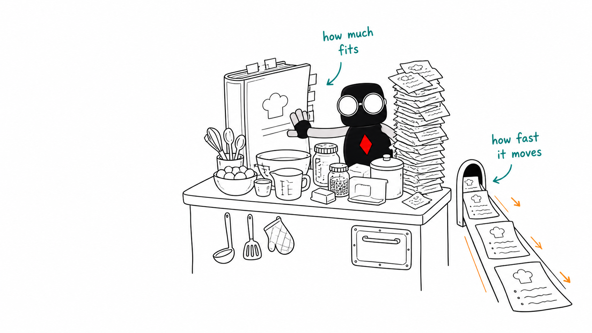

# Fit is one thing. Speed is another.

  
<strong>Memory capacity</strong> How much can fit at once

  
<strong>Memory bandwidth</strong> How quickly weights can be read

Capacity is VRAM on a GPU, or unified memory on Macs and DGX Spark. Bandwidth is measured in GB/s.

<!--
Timing: 40 seconds.

Capacity and bandwidth answer different questions. Memory capacity is the size of the counter: VRAM on a graphics card, or unified memory shared by the CPU and GPU on Macs and the DGX Spark. The model weights, the current context and temporary working memory must share it.

Memory bandwidth is how quickly the hardware can read those weights while generating. A machine can have enough capacity for a large model and still generate slowly. Another machine can be fast but too small for the model you want.

[Sources]
- https://developer.nvidia.com/blog/mastering-llm-techniques-inference-optimization/
- Illustration generated for this deck using the T Krobot illustration skill from https://github.com/tinkertanker/tkrobot-stickers on 27 August 2026.
-->

---

<!-- _class: memory-headroom-slide -->

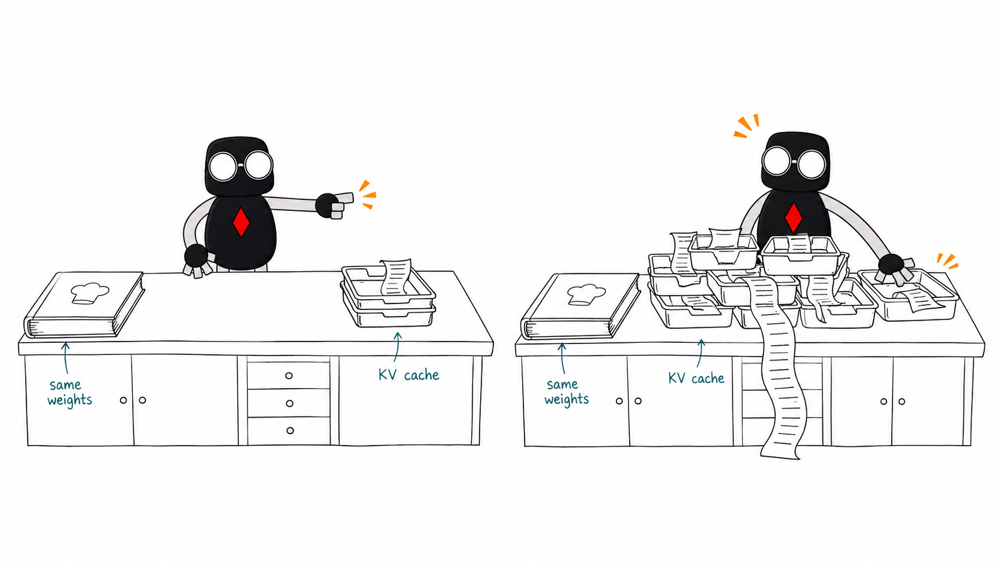

# The model fits. The conversation might not.

  
<strong>Short chat</strong>Room for context and working memory

  
<strong>Long chat</strong>Same weights, larger KV cache

  
<strong>Context</strong>The text the model can currently attend to

  
<strong>KV cache</strong>Saved keys and values from earlier tokens

<!--
Timing: 50 seconds.

Context is the instructions, conversation and generated text that the model can currently attend to.

While processing that text, the model computes keys and values for every token. The KV cache keeps them so the model does not recompute them for earlier tokens each time it generates a new one.

The weights stay the same size, but the KV cache grows with the conversation. So a model that fits with a short prompt can run out of memory in a long chat, or with many people using it at once. How fast it grows depends on the model's design, the context length and the cache settings.

Prefix caching reuses KV data when a later request starts with exactly the same text, if the runtime supports it and the cache is still there. Think of keeping the same prepared ingredients ready for the next order. It saves prompt processing, not reply generation. A cold prompt has nothing reusable cached. That's separate from whether the model itself is already loaded.

[Sources]
- https://huggingface.co/docs/transformers/main/en/kv_cache
- https://docs.vllm.ai/en/latest/features/automatic_prefix_caching/
- Illustration generated for this deck using the T Krobot illustration skill from https://github.com/tinkertanker/tkrobot-stickers on 5 September 2026.
-->

---

<!-- _class: fit-slide fit-combined -->

# What fits in local memory?

These examples may fit in memory, but that does not tell you how fast they run.

  
Memory targetModelWhat the size means

  
<strong>8 GB</strong>Gemma 4 E4BQ4_0 load ≈ 4.5 GB

  
<strong>16 GB</strong>Gemma 4 12BQ4_0 load ≈ 6.7 GB

  
<strong>16 GB</strong>gpt-oss-20bOpenAI: runs in 16 GB with MXFP4

  
<strong>24 GB</strong>Qwen3.8-27BQ4_K_M file 17.8 GB

  
<strong>24 GB</strong>Gemma 4 31BQ4_0 load ≈ 17.5 GB

  
<strong>80 GB</strong>gpt-oss-120bOpenAI: one 80 GB GPU, MXFP4

  
<strong>128 GB*</strong>GLM-5.3-FlashUD-IQ1_S file 93.1 GB; aggressive quant

  
<strong>256 GB*</strong>GLM-5.3UD-IQ2_M file 239 GB; aggressive quant

The model shares memory with its context and software, including the OS on unified-memory systems. <small>*We have not tested the 128/256 GB setups. Their low-bit quantisation may reduce quality.</small>

<!--
Timing: 60 seconds.

These are rough targets. The gpt-oss rows come straight from OpenAI. The Gemma figures are Google's Q4_0 loading estimates, which include a loading allowance but not context or other software. Qwen's 17.8 GB is the file size, not measured memory use.

The GLM rows are community low-bit builds from Unsloth, and we haven't tried them. GLM-5.3-Flash has 320 billion parameters with 18 billion active; its 1-bit build is a 93 GB file and Unsloth suggests about 102 GB of memory. The full GLM-5.3 build is 239 GB, and Unsloth asks for at least 245 GB. Squeezing a model this hard costs quality. DeepSeek-V4.1-Flash is bigger again, about 750 billion parameters, so even its 1-bit build is around 250 GB.

Leave headroom for context and, on unified memory, the operating system. Sources checked 11 November 2026. Pick a few rows to talk through rather than reading them all.

[Sources]
- https://ai.google.dev/gemma/docs/core
- https://ai.google.dev/gemma/docs/core/model_card_4
- https://huggingface.co/Qwen/Qwen3.8-27B
- https://huggingface.co/bartowski/Qwen3.8-27B-GGUF/blob/main/README.md
- https://openai.com/index/introducing-gpt-oss/
- https://unsloth.ai/docs/models/glm-5.3-flash
- https://huggingface.co/unsloth/GLM-5.3-Flash-GGUF
- https://unsloth.ai/docs/models/glm-5.3
- https://huggingface.co/unsloth/GLM-5.3-GGUF
- https://unsloth.ai/docs/models/deepseek-v4.1-flash
- https://huggingface.co/docs/transformers/main/en/kv_cache
-->

---

<!-- _class: image-copy speed-slide -->

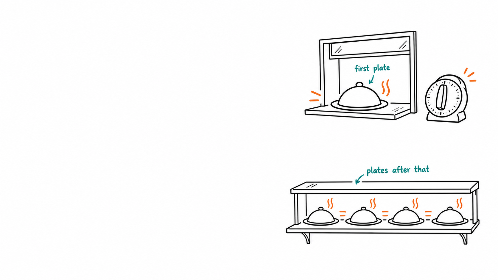

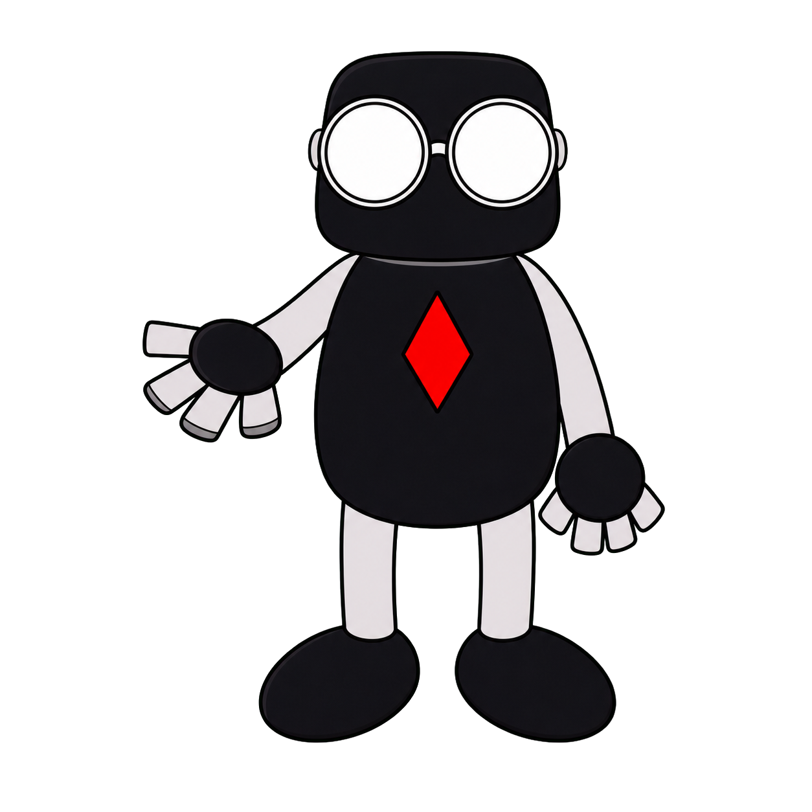

# TTFT and TPS

  
<strong>TTFT</strong>Time to first token<small><b>Prefill:</b> process the prompt before answering</small>

  
<strong>TPS</strong>Tokens per second after that<small><b>Decode:</b> generate the reply one token at a time</small>

<!--
Timing: 40 seconds.

Two systems can both feel slow, for different reasons. TTFT means time to first token: how long you wait before anything appears. Prefill is the phase where the model processes the prompt before producing that first output token.

TPS means tokens per second after generation has started. Decode is the phase where the model generates the answer one token at a time.

In a chat you feel both. Fast streaming won't make up for a long wait at the start.

[Sources]
- https://docs.vllm.ai/en/latest/features/per_request_metrics/
- https://docs.vllm.ai/en/latest/usage/metrics/
- Serving-hatch artwork generated on 12 September 2026. Original palm-open and running-right stickers from https://github.com/tinkertanker/tkrobot-stickers/tree/f4e93c2ba5c8c955e39c564491f6c4b22b7d1f7d/stickers, used unchanged.
-->

---

<!-- _class: benchmark-slide -->

# Speed claims need a recipe

How many orders, what dish, and how much prep?

  
<strong>C1 / C4: concurrency</strong>One / four requests in flight. One agent can launch several.

  
<strong>Cold prompt / prefix cache hit</strong>Prep from scratch, or reuse matching earlier work.

  
<strong>Per-user speed / total throughput</strong>Your plates per minute, or the whole kitchen’s output?

  
<strong>Speculative decoding / acceptance rate</strong>A drafter suggests tokens. The main model checks them. How many suggestions survive?

A useful benchmark shows how long you wait and how fast the reply arrives, using the same task and settings.

<!--
Timing: 55 seconds.

C1 and C4 mean one and four requests running at once. That's requests, not people: one agent with four subagents is already C4 or more. More simultaneous requests can increase total server output while slowing each user's stream. Report both, and include time waiting in the queue when measuring the user's experience.

Cold versus cached here refers to the prompt prefix. Keep model load state separate. Fix input and output lengths, reasoning settings, model/quantisation, hardware and runtime when comparing runs.

Speculative decoding uses a cheaper proposal method, such as a smaller draft model, then verifies proposed tokens with the target model. Acceptance rate is the fraction of proposed tokens accepted. High acceptance helps, but drafting and checking take time too, so it can still end up slower. MTP, multi-token prediction, is built into some models and often acts as the drafter. What's supported depends on the model and runtime.

Alex Ellis runs GLM-5.3-Flash across his four DGX Sparks, and his own measurements show how much the task matters. On the same setup he got about 30 tokens per second writing prose, 75 writing code and 110 for structured output. Structured output is predictable, so more of the drafter's guesses survive. A cold 64,000-token prompt took about 28 seconds to process; replayed from the prefix cache, under two. On his real agent traffic, about 45 is typical. Earlier, a two-Spark recipe advertised 65 to 85 tokens per second, which turned out to be measured on a counting task; he saw 30 to 40 in normal use. So test with your own work before trusting a headline number.

[Sources]
- https://blog.alexellis.io/how-and-why-we-bought-4-dgx-sparks/ (two-Spark recipe example)
- https://github.com/alexellis/glm-5.3-flash-4x-dgx-spark-switchless (measurements from 5 September 2026)
- https://docs.vllm.ai/en/latest/cli/bench/serve/ (concurrency and controlled benchmark inputs)
- https://docs.vllm.ai/en/latest/features/automatic_prefix_caching/
- https://docs.vllm.ai/en/latest/features/speculative_decoding/
- Original sticker: https://github.com/tinkertanker/tkrobot-stickers/blob/main/stickers/sus.png
-->

---

<!-- _class: tp-slide -->

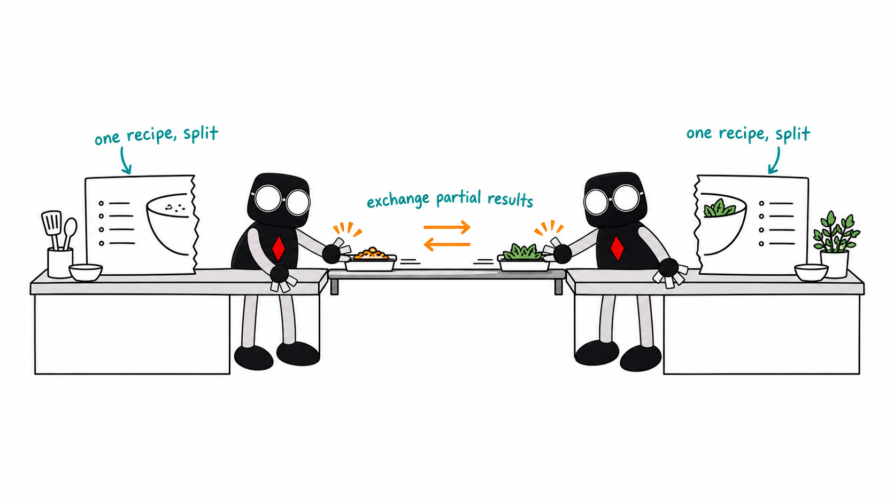

# One model across several GPUs

  
<strong>TP</strong>Split each layer's maths across GPUs

  
<strong>Within one machine</strong>NVLink or PCIe

  
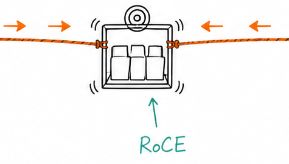<strong>Between machines</strong>RoCE or InfiniBand

<strong>NCCL</strong>: software that coordinates GPU communication

<!--
Timing: 55 seconds.

Tensor parallelism splits one model's tensor operations and weights across several GPUs. Each GPU does part of the work, then exchanges partial results with the others again and again.

A node is one machine. Inside one, GPUs talk over NVLink where the system has it, otherwise over PCIe. RoCE means RDMA over Converged Ethernet, and InfiniBand is another fast network fabric used between machines.

Pooling memory is only half of it. The GPUs talk to each other constantly, so the link between them matters. Alex Ellis's four Sparks run one model at TP4, linked in a ring over RoCE with no network switch.

NCCL, pronounced nickel, is NVIDIA's Collective Communications Library. It supplies operations that exchange and combine data among GPUs, within or across machines. In the kitchen analogy, it organises the hand-offs between cooks. The network fabric is the connection those hand-offs travel over. TP4 means four tensor-parallel participants, not four independent model copies. Linking machines does not automatically turn their RAM into one transparent pool.

[Sources]
- https://docs.vllm.ai/en/latest/serving/parallelism_scaling/
- https://github.com/alexellis/glm-5.3-flash-4x-dgx-spark-switchless
- https://docs.nvidia.com/deeplearning/nccl/user-guide/docs/overview.html
- https://docs.nvidia.com/networking-ethernet-software/cumulus-linux/Layer-1-and-Switch-Ports/Quality-of-Service/RDMA-over-Converged-Ethernet-RoCE/
- Shared-recipe and RoCE dumbwaiter artwork generated with character references from https://github.com/tinkertanker/tkrobot-stickers.
-->

---

<!-- _class: end-slide -->
<!-- _paginate: false -->

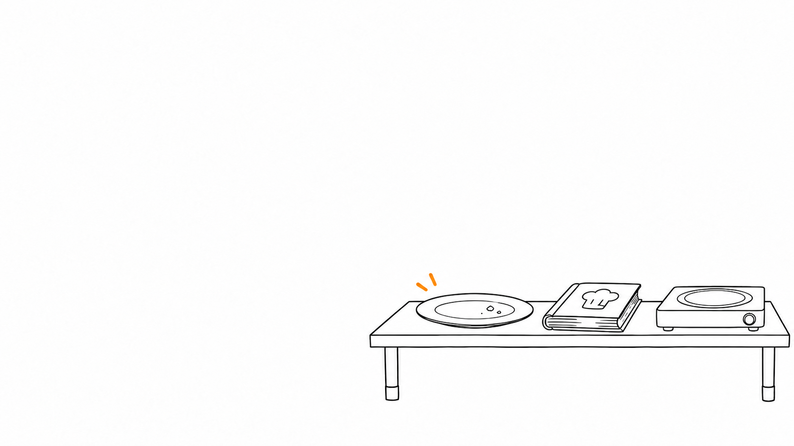

# Fits. Fast. Worth it?

  
<strong>Fits?</strong>Weights, context and working memory

  
<strong>Fast?</strong>Bandwidth, compute, TTFT and TPS

  
<strong>Worth it?</strong>Privacy and control versus effort and trade-offs

<!--
Timing: 20 seconds.

Local AI comes down to three questions: does the whole cookbook fit on the counter, do the plates arrive fast enough, and is running your own kitchen worth it? Now, when someone says “27B Q4 GGUF”, you know what to ask next.

[Sources]
- Table artwork generated on 12 September 2026. Original rubbing-tummy sticker from https://github.com/tinkertanker/tkrobot-stickers/tree/f4e93c2ba5c8c955e39c564491f6c4b22b7d1f7d/stickers, used unchanged.
-->
